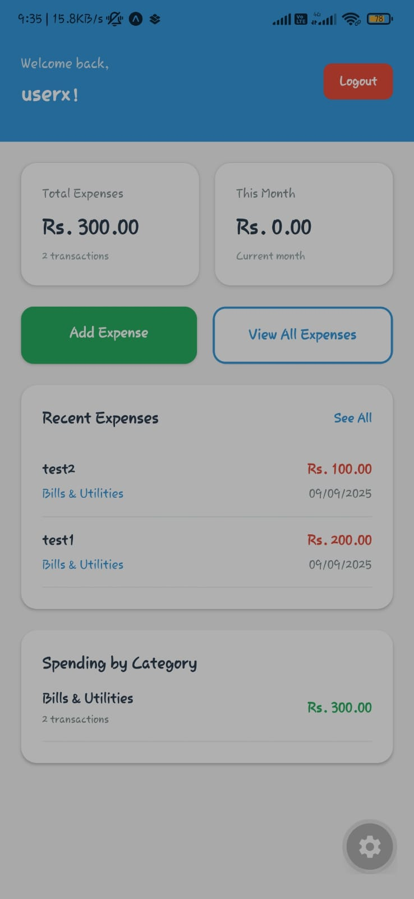
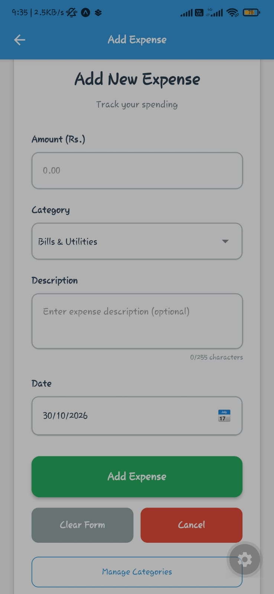
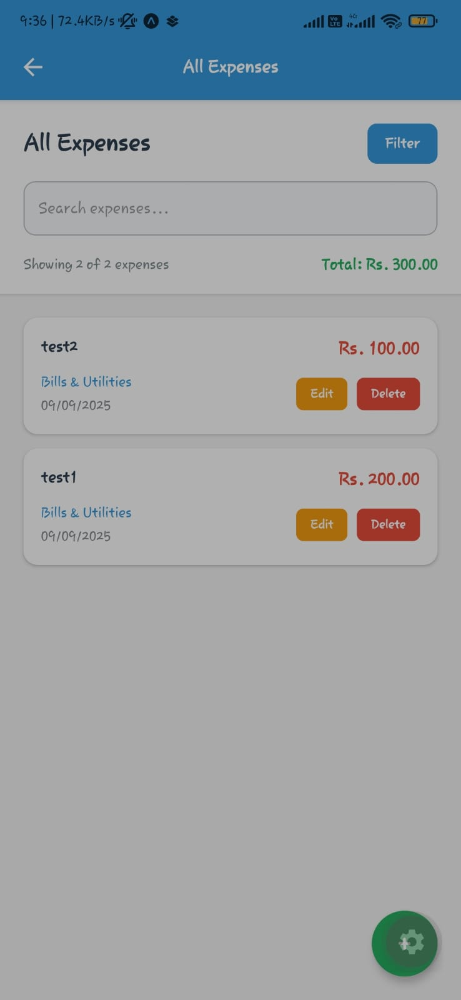

# MoneyLog Backend

**MoneyLog-Backend** is the server side of the MoneyLog expense tracker: a Java servlet web application that exposes a JSON API for the [MoneyLog mobile app](https://github.com/DhanikaJ/MoneyLog). It uses Hibernate to store users, categories and expenses in a MySQL database and is deployed as a WAR file on GlassFish.

[](LICENSE)
[]()
[]()
[]()

> **Status:** academic prototype. It is suitable for local development and demos, not for production. See [Security notes](#security-notes) and [Known Limitations](#known-limitations).

## Repositories

| Repository | Role | Technology |
|---|---|---|
| [MoneyLog](https://github.com/DhanikaJ/MoneyLog) | Mobile client | React Native (Expo), TypeScript |
| **MoneyLog-Backend** (this repo) | JSON API and database access | Java servlets, Hibernate, MySQL, GlassFish |

## Features

- **Registration and login** with email and password (passwords are stored as SHA-256 hashes)
- **Expense management:** add an expense, list a user's expenses (latest first) and delete one (only if it belongs to the given user)
- **Categories:** returned alphabetically; ten default categories are created automatically the first time the list is requested and the table is empty
- **Dashboard data:** total spent, number of transactions, this month's total, the five most recent expenses and totals per category
- **Validation and clear errors:** every endpoint returns JSON of the form `{ "success": false, "message": "..." }` with a suitable HTTP status
- **CORS headers** on every servlet so the app can call the API from another origin

## Technology Stack

| Area | Technology |
|---|---|
| Language | Java (project compile level 1.7) |
| Web layer | Java servlets (`javax.servlet`, annotation-based `@WebServlet`), Gson for JSON |
| Persistence | Hibernate 4.3.1 (Criteria API, annotated entities), MySQL Connector/J 8.4.0, c3p0 |
| Database | MySQL (database name `moneylog`) |
| Application server | GlassFish 5 (Java EE 8 web profile target) |
| IDE / build | Apache NetBeans, Apache Ant |

## Project Structure

```text
MoneyLog-Backend/
├── src/
│   └── java/
│       ├── controller/               # Servlets (the API)
│       │   ├── LoginServlet.java
│       │   ├── UserServlet.java      # Registration
│       │   ├── DashboardServlet.java
│       │   ├── CategoryServlet.java
│       │   ├── ExpenseServlet.java   # Add and delete
│       │   └── ExpenseListServlet.java
│       ├── hibernate/                # Entities and session factory
│       │   ├── Users.java
│       │   ├── Category.java
│       │   ├── Expense.java
│       │   └── HibernateUtil.java    # Reads DB_URL, DB_USER, DB_PASSWORD
│       └── hibernate.cfg.xml.template  # Copy to hibernate.cfg.xml (see Setup)
├── web/WEB-INF/glassfish-web.xml
├── nbproject/                        # NetBeans project configuration
├── build.xml                         # Apache Ant build script
├── src/img/                          # Screenshots of the mobile app
├── LICENSE
└── README.md
```

There are no JSP pages and no `web.xml`. Servlets are registered with annotations.

## Database

The application uses a MySQL database named `moneylog`. The schema script is not included in this repository yet. The tables expected by the Hibernate entities are:

| Table | Columns |
|---|---|
| `users` | `id`, `username`, `email`, `password_hash`, `created_at`, `updated_at` |
| `category` | `id`, `name` |
| `expense` | `id`, `amount`, `category_id` (FK to `category`), `description`, `dates`, `created_at`, `updated_at`, `users_id` (FK to `users`) |

Create the database and tables yourself, for example:

```sql
CREATE DATABASE moneylog CHARACTER SET utf8mb4;
```

Hibernate does not create the tables for you, because `hibernate.hbm2ddl.auto` is not set. Add `<property name="hibernate.hbm2ddl.auto">update</property>` to your local `hibernate.cfg.xml` while developing, or create the tables manually.

## Setup

### Requirements

- JDK 8 (GlassFish 5 runs on Java 8)
- GlassFish 5.x (the NetBeans project targets `gfv5ee8`)
- MySQL 8 and Apache NetBeans (recommended) or Apache Ant
- The libraries below. They are not stored in the repository (the NetBeans project points at a folder on the author's computer), so add them to the project or to `web/WEB-INF/lib`:

| Library | Version |
|---|---|
| Hibernate (core, commons-annotations, entitymanager, c3p0, ehcache) | 4.3.1.Final |
| antlr, dom4j, javassist, jboss-logging, jboss-transaction-api | 2.7.7, 1.6.1, 3.18.1-GA, 3.1.3.GA, 1.2 spec |
| c3p0, mchange-commons-java, ehcache-core | 0.9.2.1, 0.2.3.4, 2.4.3 |
| Gson | 2.10.1 |
| MySQL Connector/J | 8.4.0 |
| slf4j-api, slf4j-simple | 1.6.1 |

### 1. Database credentials

The real `src/java/hibernate.cfg.xml` is git-ignored so passwords are never committed. Create it from the template:

```bash
cp src/java/hibernate.cfg.xml.template src/java/hibernate.cfg.xml
```

You can leave the placeholder values in that file and provide the real ones as **environment variables** that `HibernateUtil` reads when the server starts:

| Variable | Example |
|---|---|
| `DB_URL` | `jdbc:mysql://localhost:3306/moneylog?useSSL=false` |
| `DB_USER` | your MySQL user |
| `DB_PASSWORD` | your MySQL password |

Set them in the environment of the process that runs GlassFish. If a variable is missing, the value from `hibernate.cfg.xml` is used instead.

### 2. Build and deploy

With NetBeans: open the project, add the libraries, then right-click the project and choose **Run** (it deploys to GlassFish and opens the context path).

With Ant:

```bash
ant clean dist        # creates dist/MoneyLog.war
```

Then deploy the WAR to GlassFish (for example with the admin console or `asadmin deploy dist/MoneyLog.war`).

The WAR is named `MoneyLog.war`, so the API is served from `http://localhost:8080/MoneyLog` by default. That is the URL the mobile app expects.

### 3. Quick check

```bash
curl http://localhost:8080/MoneyLog/CategoryServlet
```

should return JSON with `"success": true` and a list of categories.

## API Reference

Base URL: `http://<host>:8080/MoneyLog`. All requests and responses use JSON (`Content-Type: application/json`). Every error response has `success: false` and a `message`.

| Method | Endpoint | Request | Success response |
|---|---|---|---|
| `POST` | `/UserServlet` | JSON body: `username` (3+ characters), `email`, `password` (6+ characters) | `201` with `success`, `message`, `id`, `username`. Duplicate email or username returns `409`. |
| `POST` | `/LoginServlet` | JSON body: `email`, `password` | `200` with `success`, `id`, `username`, `email`, `message`. Wrong credentials return `401`. |
| `GET` | `/CategoryServlet` | none | List of categories (`id`, `name`), sorted by name. Creates the ten defaults if the table is empty. |
| `GET` | `/DashboardServlet?userId=` | query: `userId` | `success`, `totalExpenses`, `totalTransactions`, `monthlyTotal`, `recentExpenses` (latest 5) and `categoryTotals`. |
| `GET` | `/ExpenseListServlet?userId=` | query: `userId` | `success`, `expenses` (each with `id`, `amount`, `description`, `dates`, `createdAt`, `updatedAt`, `category`) and `totalCount`, latest first. |
| `POST` | `/ExpenseServlet` | JSON body: `userId`, `categoryId`, `amount` (greater than 0, at most 999,999.99), `description` (required, up to 255 characters), `dates` (`yyyy-MM-dd`) | `201` with `success`, `expenseId`, `amount`, `description`, `categoryName`, `date`. |
| `DELETE` | `/ExpenseServlet?expenseId=&userId=` | query: `expenseId`, `userId` | `200` with `success` and `deletedExpenseId`. Returns `404` if the expense is not found for that user. |
| `DELETE` | `/ExpenseListServlet?expenseId=&userId=` | query: same as above | Same behaviour as the delete above (the same operation is implemented in both servlets). |

There is no endpoint to update an expense, so the app's **Edit** button is not implemented yet.

## Screenshots of the mobile client

| Dashboard | Add expense | All expenses |
|---|---|---|
|  |  |  |

## Security notes

This project was built to learn client-server development, and several things are intentionally simple. They need to be fixed before any real use:

- **No authentication tokens.** Login returns the user id, and every other endpoint trusts the `userId` the client sends. Anyone who knows or guesses an id can read, add or delete that user's expenses.
- **Open CORS:** `Access-Control-Allow-Origin: *` is sent by every servlet.
- **Password hashing:** passwords are hashed with plain, unsalted SHA-256. A slow, salted algorithm such as bcrypt or Argon2 should be used.
- **Credentials:** database credentials come from environment variables or a git-ignored `hibernate.cfg.xml`. Never commit real credentials. If a password was ever committed, change it.
- **Verbose logs and errors:** servlets print request data to the console, `hibernate.show_sql` is on, and some error responses include the exception message.
- The MySQL connection uses `useSSL=false` in the example URL.

## Known Limitations

- No schema script or seed data (apart from the automatic default categories).
- No update endpoint, no income, accounts or budgets, and no automated tests.
- Money is stored as a floating-point `Double` (a `DECIMAL` column and `BigDecimal` would be safer).
- Amounts above Rs. 999,999.99 are rejected by a fixed limit in the code.
- The NetBeans project references libraries by absolute paths on the author's computer, and the project is compiled at Java 1.7 level with old library versions (Hibernate 4.3.1 dates from 2014).
- Compiled output (`build/`, `dist/`) was committed in the past. These folders are now listed in `.gitignore` and should not be tracked.

## Future Enhancements

- Token-based authentication (JWT or server sessions) with per-user authorization
- bcrypt password hashing and an allow-list for CORS
- Update-expense endpoint, income and budgets
- A `schema.sql` file, plus Flyway or Hibernate schema management
- Maven or Gradle build with managed dependencies
- A Dockerfile (Tomcat or GlassFish plus MySQL) for easy hosting
- Unit and integration tests

## License

This project is licensed under the MIT License. See the [LICENSE](LICENSE) file for details.

## Author

**DhanikaJ**  
Portfolio: [https://dhanikaj.dev](https://dhanikaj.dev)